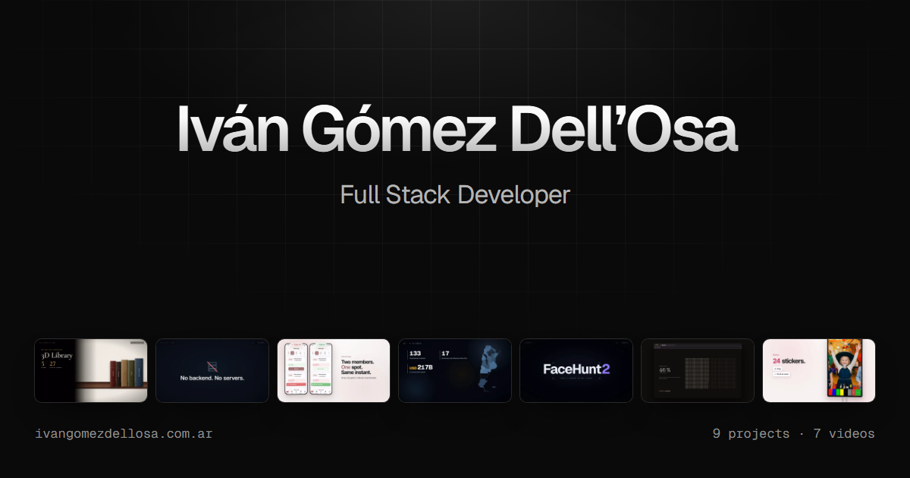

[English](README.en.md) | [Español](README.md)

<p align="center">
  
</p>

# ivangomezdellosa.com.ar

Personal portfolio of **Iván Gómez Dell’Osa**, Full Stack Developer focused on backend and applied AI. A static, bilingual (EN / ES) site with the nine projects, a video for each one and a full case study per project.

---

## 💡 The idea

**Dark, restrained and light on text: the work does the talking.** The hero holds only the name and the job title; below it, the nine projects hanging from a line, like cloths. Each project has its own section in the tint of its product (a black with the hue of its brand, and its accent color) and its video, which is the brightest thing on the page.

- **The hero cloths.** Each project hangs from a line with three clips, with a silent trailer of its video (or, for the two websites, of the site itself). The cloth is real physics (Bullet, through Ammo.js): it can be grabbed and stretched, and a clip gives way when pulled too hard; clicking a clip releases it and, with all of them released, the cloth falls and hangs itself back up. Arrows, bars, keyboard, dragging or the trackpad move between them. With reduced motion or no WebGL, a reel takes their place.
- **Each project's screen.** A silent loop from its video, with the play button on top. The loop comes from the version of the video without subtitles (the published one has them burned in) and weighs at most 1.1 MB.
- **The theater.** Pressing play on any video dims the page (the backdrop goes black and out of focus) and the video plays large, with its scenes alongside to jump to any of them and the previous and next videos at the bottom. Esc closes it and returns focus where it was.

**Two typographic voices, one family.** Geist is the human voice: what is told and decided. Geist Mono is the machine's voice and only carries what can be verified: measured numbers, stack, dates, durations and addresses.

---

## 🎯 Features

- **A video per project**, published on YouTube: narrated in English, with Spanish subtitles. The websites (Rugidos, Navkok) have none: they can be seen with one click.
- **Scenes.** Each video has an index with the exact times from its Remotion timeline; on the case study it reads as a table of contents, and each scene opens the video at that second.
- **YouTube only on play.** The API and the player (from `youtube-nocookie.com`) load on the first click: visitors who do not watch a video download nothing from YouTube. Without JavaScript, every button is a link to the video.
- **Each project's data, drawn from its real data.** Ask Leonardo's vector space with its 1,402 vectors, the measured result (96.9% against 0 of 187), Datos Pauta's coverage by jurisdiction, the layers of Inversiones en Argentina, SeViVe's architecture, the MementoLife grid drawn live and FreeMagicMirror's real screens.
- **The résumé in both languages, always.** The «Resume» button offers the Spanish CV and the English resume on both versions of the site. They are the 10-26 v2 ones, printed without the phone number (`tools/cv.mjs`): a PDF on a public site is also read by number-harvesting bots.
- **Index and stack with evidence.** The nine projects in a table up front; every technology in the résumé, with the projects where it was used.
- **Full case studies** at `/proyectos/<slug>/` and `/en/projects/<slug>/`: the video, the story, the features and why they exist, the architecture, the stack and the results.
- **Bilingual**, with one URL per language, `hreflang`, canonical URLs and structured data (`Person`).

---

## 🛠️ Tech Stack

| Layer | Technology |
|------|------------|
| **Framework** | Next.js 16 (App Router) with static export, React 19, strict TypeScript |
| **Styling** | CSS with oklch variables and CSS Modules, no UI libraries |
| **Video** | YouTube iframe API (lazy-loaded), native `<dialog>`, H.264 loops with `<source media>` |
| **3D** | Three.js with a custom shader for the cloths; cloth physics from Bullet compiled to WebAssembly (Ammo.js), loaded after the hero |
| **Visualizations** | Canvas 2D (vector space) and SVG (weeks grid), no dependencies |
| **Typefaces** | Geist and Geist Mono, self-hosted with `next/font` |
| **Media** | Remotion (subtitle-free trailers), Playwright (recording a website), FFmpeg (seamless loops and crossfades) and Sharp |
| **Tooling** | Playwright (screenshots, social image, visual review) |

---

## 📊 Measured quality

| | Result |
|---|---|
| Accessibility (axe-core, WCAG 2.0, 2.1 and 2.2 AA) | **0 violations** on the home page and case studies, desktop and mobile, and with the résumé menu and the theater open |
| Contrast of each palette (`npm run contraste`) | ink ≥ 15.9:1, secondary ≥ 9.5:1, labels ≥ 6.2:1, accents ≥ 7.3:1 |
| Reduced motion and data saver | respected: no cloths or videos start on their own; the reel stays on its posters |
| Home page initial load | 2.7 MB on desktop and 2 MB on mobile, reel included (1.4 MB and 0.6 MB); typefaces, 52 KB |
| Generated pages | 24 (home page and 9 case studies per language, 404, sitemap and robots) |

---

## 🚀 Development and publishing

```bash
npm install
npm run dev          # http://localhost:3000
npm run build        # builds the static site into out/
npm run preview      # serves out/ the way the host would (http://localhost:4173)
```

When a project changes:

```bash
npm run videos       # trailers, loops, posters and reel from the portfolio-videos repo (renders what is missing with Remotion)
npm run capturas     # re-captures the live sites (tools/_capturas/)
npm run medios       # regenerates public/medios from the sibling repositories and the captures
npm run cv           # when the résumé changes (CV_VERSION=11-26 npm run cv)
npm run og           # the social sharing image
```

To publish on **ivangomezdellosa.com.ar**: register the domain at NIC Argentina, push the repository to GitHub, import it in Vercel (it detects Next.js and the static export), add `www.ivangomezdellosa.com.ar` (canonical) and the apex redirecting to `www`, and delegate the domain at NIC Argentina to the DNS servers Vercel indicates.

---

## 📝 Development Notes

Built with AI assistance. The content comes from each project's approved texts (their READMEs, the résumé and the LinkedIn profile) and follows the recorded decisions on what to say and what not to say about each one. The videos are on YouTube, made with Remotion in the `portfolio-videos` repository; the site only takes silent segments for the previews.

---

## 👤 Author

**Iván Gómez Dell’Osa**

- Email: [ivangomezdellosa@gmail.com](mailto:ivangomezdellosa@gmail.com)
- LinkedIn: [linkedin.com/in/ivangomezdellosa](https://www.linkedin.com/in/ivangomezdellosa/)
- GitHub: [IvanGomezDellOsa](https://github.com/IvanGomezDellOsa)
