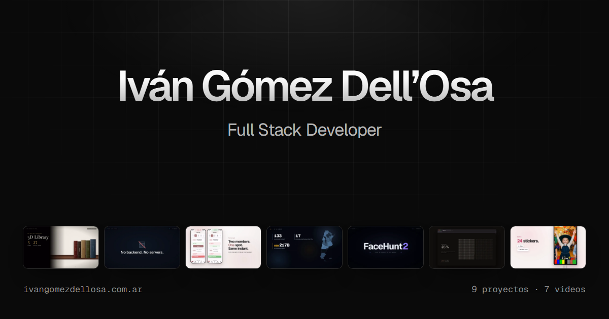

[Español](README.md) | [English](README.en.md)

<p align="center">
  
</p>

# ivangomezdellosa.com.ar

Portfolio personal de **Iván Gómez Dell’Osa**, Full Stack Developer con foco en backend e IA aplicada. Sitio estático y bilingüe (ES / EN), con los nueve proyectos, el video de cada uno y un caso completo por proyecto.

---

## 💡 La idea

**Oscuro, sobrio y con poco texto: lo que habla es el trabajo.** El hero tiene sólo el nombre y el puesto; debajo, los nueve proyectos colgados de un hilo, como telas. Cada proyecto tiene su sección con el tinte de su producto (un negro con el matiz de su marca y su color de acento) y su video, que es lo que más brilla.

- **Las telas del hero.** Cada proyecto cuelga de un hilo con tres broches, con un tráiler mudo de su video (o, en los dos sitios web, de su página). La tela es física de verdad (Bullet, vía Ammo.js): se agarra, se estira, y si se tira mucho el broche cede; un clic en un broche lo suelta y, sueltos todos, la tela se cae y se vuelve a colgar. Se recorren con flechas, barras, teclado, arrastre o el trackpad. Con movimiento reducido o sin WebGL, en su lugar va un reel.
- **La pantalla de cada proyecto.** Un fragmento mudo del video en loop, con el play encima. El fragmento sale de la versión sin subtítulos del video (el publicado los lleva quemados) y no pesa más de 1,1 MB.
- **El teatro.** Al darle play a cualquier video, la página se apaga (el fondo baja a negro y se desenfoca) y el video se ve grande, con sus escenas al lado para saltar a cada una y el video anterior y el siguiente al pie. Se cierra con Esc y devuelve el foco a donde estaba.

**Dos voces tipográficas, una sola familia.** Geist es la voz humana: lo que se cuenta y se decide. Geist Mono es la voz de la máquina y sólo lleva lo verificable: números medidos, stack, fechas, duraciones y direcciones.

---

## 🎯 Funcionalidades

- **Un video por proyecto**, publicado en YouTube: narrados en inglés, con subtítulos en español. Los sitios web (Rugidos, Navkok) no tienen: se ven con un clic.
- **Escenas.** Cada video tiene su índice con los tiempos exactos de su línea de tiempo en Remotion; en el caso completo se lee como una tabla de contenidos y cada escena abre el video en ese segundo.
- **YouTube recién al hacer play.** La API y el reproductor (desde `youtube-nocookie.com`) se cargan con el primer clic: quien no mira videos no descarga nada de YouTube. Sin JavaScript, cada botón es un enlace al video.
- **Los datos de cada proyecto, dibujados con sus datos reales.** El espacio vectorial de Ask Leonardo con sus 1.402 vectores, el resultado medido (96,9% contra 0 de 187), la cobertura de Datos Pauta por jurisdicción, las capas de Inversiones en Argentina, la arquitectura de SeViVe, la grilla de MementoLife dibujada en vivo y las pantallas reales de FreeMagicMirror.
- **El CV en los dos idiomas, siempre.** El botón «CV» ofrece el CV en español y el resume en inglés en las dos versiones del sitio. Son los del CV 10-26 v2, impresos sin teléfono (`tools/cv.mjs`): el PDF de un sitio público lo leen también los programas que juntan números.
- **Índice y stack con evidencia.** Los nueve proyectos en una tabla al principio; cada tecnología del CV, con los proyectos donde se usó.
- **Casos completos** en `/proyectos/<slug>/` y `/en/projects/<slug>/`: el video, la historia, las funcionalidades con su porqué, la arquitectura, el stack y los resultados.
- **Bilingüe**, con una URL por idioma, `hreflang`, canónicas y datos estructurados (`Person`).

---

## 🛠️ Stack Tecnológico

| Capa | Tecnología |
|------|------------|
| **Framework** | Next.js 16 (App Router) con exportación estática, React 19, TypeScript estricto |
| **Estilos** | CSS con variables en oklch y CSS Modules, sin librerías de UI |
| **Video** | API de iframes de YouTube (carga diferida), `<dialog>` nativo, loops H.264 con `<source media>` |
| **3D** | Three.js con un shader propio para las telas; la física de tela, Bullet compilado a WebAssembly (Ammo.js), cargados después del hero |
| **Visualizaciones** | Canvas 2D (espacio vectorial) y SVG (grilla de semanas), sin dependencias |
| **Tipografías** | Geist y Geist Mono, servidas desde el propio dominio con `next/font` |
| **Medios** | Remotion (tráilers sin subtítulos), Playwright (la grabación de un sitio), FFmpeg (loops sin costura y fundidos) y Sharp |
| **Herramientas** | Playwright (capturas, imagen para redes, revisión visual) |

---

## 📊 Calidad medida

| | Resultado |
|---|---|
| Accesibilidad (axe-core, WCAG 2.0, 2.1 y 2.2 AA) | **0 fallas** en portada y casos, en escritorio y teléfono, y con el menú del CV y el teatro abiertos |
| Contraste de cada ambiente (`npm run contraste`) | tinta ≥ 15,9:1, secundaria ≥ 9,5:1, etiquetas ≥ 6,2:1, acentos ≥ 7,3:1 |
| Movimiento reducido y ahorro de datos | respetados: no hay telas ni videos que arranquen solos; el reel queda en sus pósters |
| Carga inicial de la portada | 2,7 MB en escritorio y 2 MB en teléfono, el reel incluido (1,4 MB y 0,6 MB); tipografías, 52 KB |
| Páginas generadas | 24 (portada y 9 casos por idioma, 404, sitemap y robots) |

---

## 📁 Dónde está cada cosa

```text
app/                      Rutas: (es) en la raíz, (en) bajo /en; raiz.tsx comparte fuentes y metadatos
src/contenido/
  proyectos.ts            Los nueve proyectos (sección, video con escenas y caso completo), en los dos idiomas
  sitio.ts                Hero, índice, video, sobre mí, experiencia, stack con evidencia, contacto
  salas.ts                El tinte de cada proyecto (paletas en oklch, medidas)
  reel.json               Los cortes del reel (lo escribe tools/videos.mjs)
src/componentes/          Hero, Telas, Reel, Indice, Sala, Pantalla, Teatro, Caso, Galeria y las visualizaciones
src/lib/telas/            Las telas: la escena y la física (motor.ts) y el shader (comun.ts)
public/vendor/ammo/       Ammo.js (Bullet en WebAssembly, licencia zlib)
public/medios/videos/     Loops, pósters y reel generados por tools/videos.mjs
public/medios/            Capturas y medios generados por tools/medios.mjs
public/cv/                CV y Resume sin teléfono (tools/cv.mjs)
tools/                    Videos, capturas, medios, CV, iconos, imagen para redes, contraste, revisión
```

**Para cambiar un texto**, se edita `src/contenido/proyectos.ts` o `src/contenido/sitio.ts`: cada texto está en español y en inglés, uno al lado del otro. El video de un proyecto (su id de YouTube, su duración y sus escenas) está en el campo `video` de ese proyecto.

---

## 🚀 Desarrollo y publicación

```bash
npm install
npm run dev          # http://localhost:3000
npm run build        # genera el sitio estático en out/
npm run preview      # sirve out/ como lo haría el hosting (http://localhost:4173)
```

Cuando cambia un proyecto:

```bash
npm run videos       # tráilers, loops, pósters y reel desde el repo portfolio-videos (renderiza con Remotion lo que falte)
npm run capturas     # vuelve a capturar los sitios en vivo (tools/_capturas/)
npm run medios       # regenera public/medios desde los repositorios hermanos y las capturas
npm run cv           # cuando cambia el CV (CV_VERSION=11-26 npm run cv)
npm run og           # la imagen para compartir en redes
npm run iconos       # los íconos, desde public/favicon.svg
npm run contraste    # mide el contraste de cada paleta
```

`npm run videos` renderiza cada fragmento desde la composición «-SinSubtitulos» de su video en `../portfolio-videos` (o la ruta de `VIDEOS_REPO`) y lo guarda en `tools/_videos/`; si el render ya existe, no lo repite.

### Publicar en ivangomezdellosa.com.ar

1. **Registrar el dominio** en [NIC Argentina](https://nic.ar) con Clave Fiscal (hoy no existe en DNS).
2. **Subir el repositorio** a GitHub.
3. **Importarlo en Vercel.** Detecta Next.js y la exportación estática sin configuración extra.
4. **Dominio en Vercel:** agregar `www.ivangomezdellosa.com.ar` (canónico) y `ivangomezdellosa.com.ar` con redirección a `www`.
5. **Delegar el dominio en NIC Argentina** a los servidores DNS que indique Vercel (o a Cloudflare, como en Datos Pauta Oficial, si se prefiere Cloudflare Pages: el sitio es estático y funciona igual).

La URL canónica está en `SITIO` (`src/contenido/sitio.ts`): si se publica en otro host, se cambia ahí.

---

## 📝 Notas de Desarrollo

Desarrollado con asistencia de IA. El contenido sale de los textos aprobados de cada proyecto (sus README, el CV y el perfil de LinkedIn) y respeta las decisiones registradas sobre qué decir y qué no de cada uno. Los videos están en YouTube, hechos con Remotion en el repo `portfolio-videos`; el sitio sólo toma fragmentos mudos para las vistas previas.

---

## 👤 Autor

**Iván Gómez Dell’Osa**

- Email: [ivangomezdellosa@gmail.com](mailto:ivangomezdellosa@gmail.com)
- LinkedIn: [linkedin.com/in/ivangomezdellosa](https://www.linkedin.com/in/ivangomezdellosa/)
- GitHub: [IvanGomezDellOsa](https://github.com/IvanGomezDellOsa)
